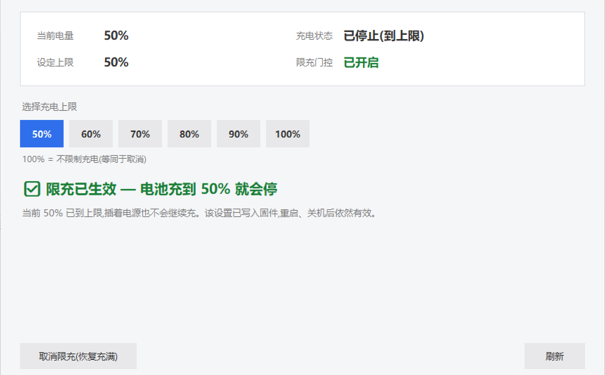

# Battery Charge Limit for Mechrevo / TongFang (Uniwill) laptops on Windows

> The OEM "battery protection mode" in Mechrevo Control Console often does nothing — the battery keeps
> charging to 100%. This project sets a real charge limit (e.g. 50%) on Windows, and the setting
> **survives reboot, shutdown and unplugging the adapter** — no background service, no startup task,
> no admin rights required.

**Scope: laptops using the Uniwill / TongFang EC firmware family** (Mechrevo, XMG, TUXEDO, Eluktronics,
some Hasee / Huoying models). It is **not** a universal tool — Lenovo / Dell / HP / ASUS / Acer / Apple
use completely different EC firmware, and those vendors usually ship their own working utilities.

Tested on: **Mechrevo WUJIE15XA (Ryzen 7 8745HS, BIOS N.1.14MRO50)**



## The problem

The EC firmware gates the charge-limit control loop behind a product-line check:

```c
bool state_is(uint8_t v) { return xram[0x07C3] == v || xram[0x0770] == v; }

bool limit_enabled = state_is(4) || state_is(5);
if (!limit_enabled) {
    uint8_t stored = xram[0x087F] & 0x7f;
    if (stored == 0 || stored > 100) { disable_control(); return; }
}
enable_control();   // uses live limit xram[0x07B9]
store_limit();      // live limit -> stored limit xram[0x087F]
```

On this machine `0x07C3 = 0x07` and `0x0770 = 0xFF`, so the gate never opens and writes to `0x07B9`
are silently ignored — that is why the OEM switch appears to do nothing.

## The approach: trigger the firmware's own store path

Instead of pinning the ROM ID (`0x0770 = 0x04`) — which touches an identity byte and is volatile —
this project briefly makes the gate condition true, so the firmware copies the live limit into its
stored-limit area. Afterwards the gate stays open on its own:

```
1. write 0x07B9 = <limit %>
2. write 0x07C3 = 0x04, hold 2.5 s      # gate temporarily true -> firmware runs store_limit()
3. write 0x07C3 back to its original value (0x07 on this machine), then read it back
4. wait 7 s, read 0x0742 bit2 == 1      # success
```

### Verified persistence

| Scenario | Result |
|---|---|
| Reboot | ✅ kept |
| Shutdown + unplug adapter + 10 min | ✅ kept |
| Then charging from 48% | ✅ stops exactly at 50% (`Charging=False`, `ChargeRate=0`) |
| Background process needed | ❌ none (nothing was running during the test) |
| Admin rights needed | ❌ none |
| Identity byte modified | ❌ no — `0x0770` stayed `0xFF` |

## Usage

```powershell
pythonw 电池充电上限.pyw
```

Buttons: 50 / 60 / 70 / 80 / 90 / 100 %, plus **"取消限充（恢复充满）"** (disable) which clears both the
live limit and the stored limit and immediately restores normal charging.

Requires Python 3 with tkinter, and the Mechrevo Control Console (it provides `UWACPIDriver.sys`,
device node `\\.\ACPIDriver`).

## "Where is the EC?" — check which family your laptop belongs to

The most common feedback is "I followed the README, but I can't find the EC on my machine". That is
usually **not** a usage mistake: Mechrevo ships several different platforms, and the register layout /
access path differs between them.

| Your laptop | Platform | Works with this project? | How to tell |
|---|---|---|---|
| WUJIE 15X (the tested unit) | Uniwill/TongFang + AMI BIOS | ✅ no admin needed | `INOU0000` exists, `\\.\ACPIDriver` opens |
| WUJIE 14 SE (7445HS) and similar | same EC family, but Windows exposes **no** `INOU0000` device | ⚠️ use the vendor ACPI-WMI classes instead (needs admin) | `ACPI\PNP0C14\HWMI` exposes `EmdAcpi_BatteryChargeRationing` |
| WUJIE 14X (GX4HRXL / 14XA) | Uniwill, EC XRAM behind a 4 KiB MMIO window | ⚠️ similar registers, different path | `INOU0000` present, access path is yours to build |
| WUJIE 14 Pro (WUJIE14 Series-HPT) | only `WMID.WMAA`; no `INOU` in the DSDT | ❌ most likely not usable (no success report yet) | run the probe script below |
| Xingyao 14 (P916F-STX) | **a different system**: Insyde H2O firmware + ITE IT5571 EC | ❌ not usable | no `INOU0000` / `ECRR` / `ECRW`; the limiter lives in the ITE PMC2 command family (T1/T2 thresholds in EC XRAM `0x0D13` / `0x0D14`, ports `0x68` / `0x6C`), which needs kernel-mode port I/O |

> The Xingyao 14 row comes from a third-party reverse-engineering reference
> ([YMGPwcca/Mechrevo-Xingyao-14](https://github.com/YMGPwcca/Mechrevo-Xingyao-14)), which explicitly
> rejects both "the generic Uniwill offsets `0x07B9`/`0x07D0` apply here" and "`INOU0000`/`ECRR`/`ECRW` exist".
> The WUJIE 14 Pro row is an **inference** (no public Windows path, no success report seen yet).

### 30-second self-check (read-only, changes nothing)

```powershell
powershell -NoProfile -ExecutionPolicy Bypass -File tools/probe_charge_channels.ps1
```

It reports the machine identity, whether the no-admin channel opens (if `0x0740` reads back, you can use
this project), and which vendor battery classes exist under `root\WMI`. **It writes no register, no
registry key, no power setting.** When opening an issue, paste its full output.

### If there is no EC channel, try in this order

1. **Vendor ACPI-WMI battery classes first.** `EmdAcpi_BatteryChargeRationing` (GUID `6B40A935-...`):
   you must **enumerate the instance and call `Invoke-CimMethod` on it** (class-level calls fail with
   "invalid method parameter"), and it needs admin. Measured on a WUJIE 14 SE (7445HS):
   `SetBatteryChargeRationing(Data)` takes the limit percentage 0-100, `0` = full — same semantics as
   EC `0x07B9`. Verify read-only on your own model first.
2. **Check whether the OEM control center implements it but hides the entry.** On several models the
   shipped `GCUService` does implement `BatteryProtection2` (`Set|ReadBatteryChargingLimit_Up`/`_Down`,
   `CHARGING_UP_LIMIT`/`DOWN_LIMIT`/`RECOVERY`), the UI simply does not expose it for that SKU.
3. **Direct EC writes need two preconditions**: `INOU0000` in ACPI, and a path to H2RAM (the OEM
   driver's `\\.\ACPIDriver`, or the WMI mailbox). Missing either one is not a parameter problem.
4. **Machines like the Xingyao 14** keep the limiter behind ITE PMC2 port I/O, which requires kernel-mode
   port access on Windows. This project does not do that, and we do not recommend users roll their own.
5. **Do not**: blind-flash BIOS/EC firmware, redistribute someone else's OEM kernel driver, or reach for
   a generic "EC writer" (WinRing0-style). The Linux kernel documentation warns that forcing a
   charge-threshold interface on a device that implements it poorly **may damage the battery**.

## Risk / disclaimer

Writes go to undocumented EC registers — community reverse-engineering, not a supported feature.
The Linux kernel documentation warns that forcing the charge-threshold interface on devices that do not
properly implement it *may damage the battery*. Verified working and reversible on WUJIE15XA, but no
long-term guarantee. All writes are volatile RAM (except the stored-limit area); no firmware flashing.
Use at your own risk.

## Credits

[w568w](https://gist.github.com/w568w/957976b59906e0ce5d6c13ad342e1593) ·
[losewayy/uniwill-ec-charge-limit](https://github.com/losewayy/uniwill-ec-charge-limit) ·
[ArchWiki: Mechrevo WUJIE14X](https://wiki.archlinux.org/title/Mechrevo_WUJIE14X) ·
[tuxedo-drivers](https://github.com/tuxedocomputers/tuxedo-drivers) ·
[Linux `uniwill-laptop` driver](https://docs.kernel.org/next/admin-guide/laptops/uniwill-laptop.html)

Technical details and pitfalls: [`docs/FINDINGS.md`](docs/FINDINGS.md)

MIT License
